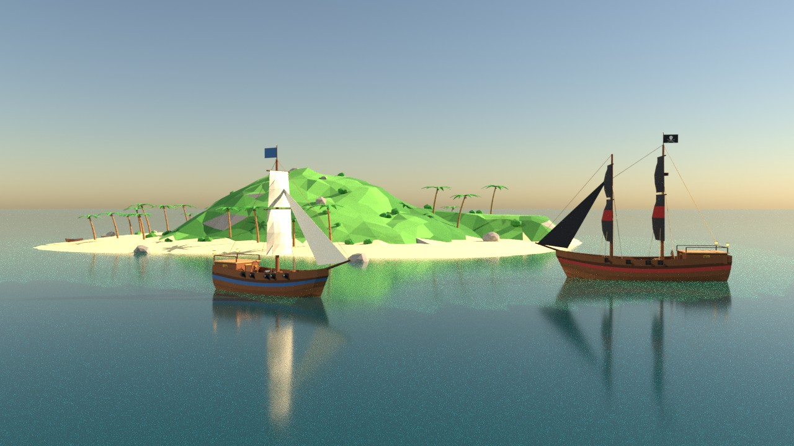
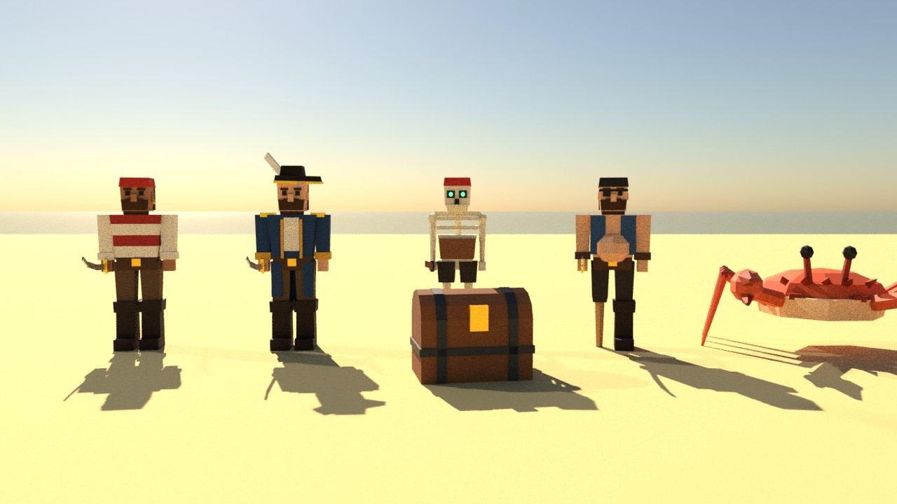
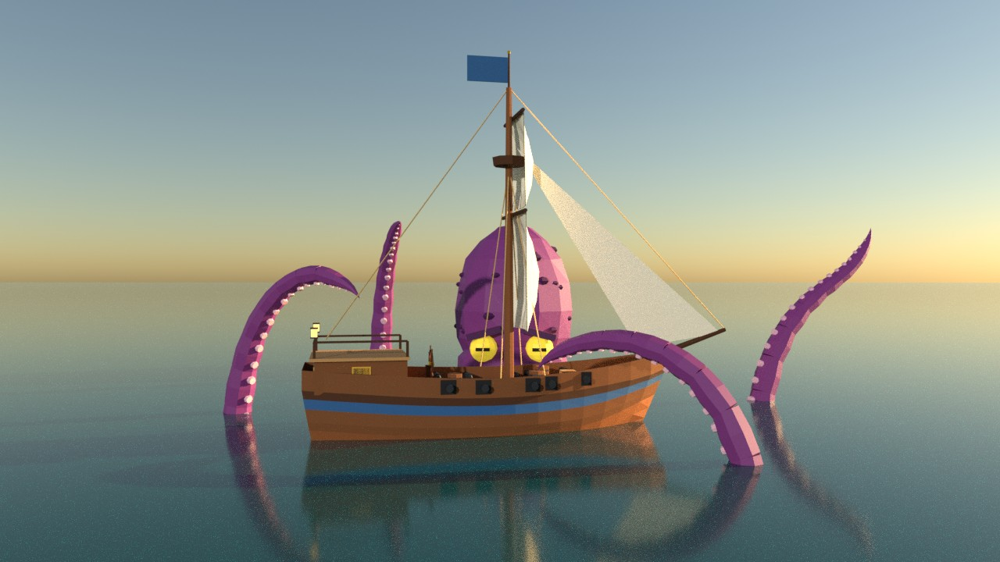

# Клад Кровавой Бороды

Приключенческая игра про корабли в Карибском море на **Unity + Blender**. Вы плаваете между островами,
сражаетесь с пиратами и морскими чудовищами, высаживаетесь на берег, бьётесь на саблях и откапываете клады.



| Персонажи | Кракен |
|---|---|
|  |  |

*Рендеры сделаны в Blender (Cycles) из тех же моделей, что и в игре.*

## Сюжет

Знаменитый пират Кровавая Борода зарыл несметные сокровища на **Острове Черепа**. Его карта разорвана
на три части и спрятана на Острове Попугаев, Черепашьем острове и Острове Висельника. Соберите карту,
победите **Кракена**, который сторожит бухту Острова Черепа, и выкопайте легендарный клад.

## Что есть в игре

- **Море.** Корабль с парусами (4 положения), рулём и ветром. Качка на волнах Герстнера: одни и те же волны
  считаются в шейдере воды и в коде, поэтому корабль качается ровно на видимых волнах. Прозрачная вода,
  сквозь которую у островов видно песчаное мелководье.
- **Морской бой.** Бортовые залпы с левого и правого борта, баллистика ядер и прицел с траекторией.
  Пираты (шлюпы и бриги) патрулируют, заходят бортом, стреляют с упреждением и удирают, когда тонут.
  Потопленные корабли оставляют бочки с золотом.
- **Монстры.** Морской змей подкрадывается под водой, выныривает и кусает корабль. **Кракен** (босс):
  щупальца бьют туда, где на воде вспенилось кольцо, а после уничтожения щупалец всплывает уязвимая голова.
- **Острова пешком.** Капитан ходит, бегает, прыгает, бьёт саблей и ставит блок. На островах ждут пираты,
  громилы с деревянной ногой, скелеты и гигантские крабы. Клады откапываются у красных крестов.
- **7 островов:** Порт Санта-Роза (город, маяк, форт, причал), Остров Попугаев (джунгли и руины),
  Черепаший остров (лагерь пиратов), Остров Висельника (частокол и виселица), Остров Туманов (скелеты
  и разбитый корабль), Песчаная коса и Остров Черепа (скала-череп и логово Кракена).
- **Порт:** ремонт, улучшения корпуса, парусов и пушек (до 5 пушек на борт), слухи в таверне, автосохранение.
- **Интерфейс:** главное меню, сюжетное вступление, HUD, компас, миникарта, большая карта (M), пауза
  с настройками громкости и мыши, экраны поражения и победы. Всё на русском.
- **Звук и музыка** синтезируются кодом: пушки, всплески, звон сабель, рёв монстров, шум моря,
  оригинальная морская песня и боевая тема. Аудиофайлы не нужны.

## Как запустить

Нужен **Unity 6 (6000.x)** или **Unity 2022.3 LTS** с Built-in Render Pipeline или URP.

1. Unity Hub → **Add** → **Add project from disk** → выберите папку `CaribbeanTreasure`.
2. Если Hub спросит версию редактора, выберите установленную (проект записан под 6000.0.23f1, но
   подойдёт любая 2022.3+ или 6.x). Нажмите «Continue», если Unity предложит сменить версию.
3. Первый импорт займёт пару минут. Затем автоматически создастся и откроется сцена
   `Assets/Scenes/Main.unity` (её также открывает меню **Caribbean → Открыть игровую сцену**).
4. Нажмите **Play**.

> Если Unity покажет вопрос про Input System («enable the backends?»), подойдёт любой ответ: игра
> поддерживает и старый Input Manager, и новый Input System. Если ввод не работает совсем, включите
> *Edit → Project Settings → Player → Active Input Handling = Both*.

Игра стартует и без сцены: при нажатии Play в любой сцене объект игры создаётся сам.

**Сборка:** *File → Build Settings* (в Unity 6 — *Build Profiles*) → Windows/Mac/Linux → **Build**.

## Управление

| В море | |
|---|---|
| W / S | поднять / убрать паруса |
| A / D | руль |
| Мышь, колесо | осмотреться, приблизить |
| ЛКМ | залп бортом, куда смотрит камера |
| Q / E | залп левым / правым бортом |
| ПКМ (держать) | траектория ядер; наклон камеры меняет дальность |
| F | высадиться на остров / войти в порт |

| На суше | |
|---|---|
| WASD, Shift, Пробел | ходьба, бег, прыжок |
| ЛКМ / ПКМ | удар саблей / блок |
| E (держать) | копать клад у красного креста |
| F | вернуться на корабль (у шлюпки) |

**M** — карта, **Esc** — пауза, **F1** — подсказка по управлению.

**Советы.** Пираты стреляют, когда вы у них на траверзе: заходите с носа или кормы. Против ветра корабль
идёт медленнее, направление ветра показывает флаг. Змей уязвим, только пока он над водой. Когда Кракен
готовит удар, вода под целью вспенивается кольцом: не стойте на месте.

## Структура проекта

```
Assets/
  Resources/
    Models/         FBX-модели из Blender (генерируются скриптом, см. ниже)
    Shaders/        вода, небо, частицы (работают и в Built-in, и в URP)
    Palette.json    палитра материалов — общая для Blender и Unity
  Scripts/
    Core/           Game (состояния, прогресс), ввод, сохранения, материалы, звук, эффекты
    World/          волны, океан, небо/туман, острова, клады, добыча, камера, ветер
    Ship/           корабль, ядра, управление игрока, ИИ пиратов, флот
    Characters/     капитан, враги на суше, процедурная анимация
    Monsters/       морской змей, Кракен
    UI/             интерфейс (IMGUI)
    Editor/         настройки импорта FBX, создание сцены, меню Caribbean
Blender/
  build_models.py         собирает ВСЕ модели: .blend + FBX
  caribbean_models/       генераторы: ships, islands, characters, monsters, props, core
  render_showcase.py      витринные рендеры
  check_fbx.py            проверка FBX (метры, плоская иерархия, без поворотов)
  blend/                  исходники .blend — их можно открывать и править в Blender
```

Сцена почти пустая: весь мир (острова, океан, корабли, интерфейс) строится кодом при запуске,
так проще менять игру и сложнее что-то сломать в редакторе.

## Blender-конвейер

Все модели (корабли, острова с растительностью и постройками, персонажи, монстры, сундуки) **генерируются
Python-скриптами Blender**. Перегенерировать модели (Blender 4.x):

```bash
blender -b --factory-startup -P Blender/build_models.py
```

Только некоторые модели и с превью-рендерами:

```bash
blender -b --factory-startup -P Blender/build_models.py -- --only Ship_Player,Captain --render
```

Затем вернитесь в Unity: изменённые FBX переимпортируются сами.

**Правила, которых ждёт код Unity:**
- 1 юнит = 1 метр, модель «смотрит» по −Y в Blender (в Unity это +Z).
- Все объекты модели — прямые дети корня. Экспорт FBX с «Apply Transform» ломает более глубокую иерархию,
  связи «рука → сабля» строятся уже в Unity. Проверить файлы: `python3 Blender/check_fbx.py`.
- Имена материалов совпадают с `Palette.json`, в Unity материалы подменяются по имени.
- Части персонажей: `Body`, `Head`, `ArmL`, `ArmR`, `LegL`, `LegR`, `Sword`, `HandR`. Точка вращения
  каждой части стоит в суставе, анимация процедурная.
- Корабли: `Hull`, `Sail_*` (ось вращения на рее, чтобы паруса сворачивались), `Flag`, `Wheel`, `Helm`,
  `CannonGun_L/R_n` и `CannonMuzzle_L/R_n`.
- Острова: `Terrain`, а также пустышки-маркеры `Landing`, `Anchor`, `Treasure_Main`, `Treasure_Legend`,
  `Treasure_n`, `Spawn_Pirate_n`, `Spawn_Crab_n`, `Spawn_Skeleton_n`, `PortDock`, `KrakenLair`.
  Коллайдеры добавляются по именам объектов (`Rock_*`, `House_*`, `Palm_*`…), огонь — к `Torch_*`
  и `Campfire_*`. Можно открыть `Blender/blend/Island_*.blend`, передвинуть маркеры или постройки
  и экспортировать FBX с теми же настройками.

## Что легко поменять

- **Цвета** всех материалов: `Assets/Resources/Palette.json`. Для Blender перегенерируйте модели,
  Unity подхватит цвета сразу.
- **Расположение и названия островов:** `Assets/Scripts/World/WorldBuilder.cs`.
- **Характеристики кораблей и цены улучшений:** `SaveData.cs` (игрок), `ShipStats` в `Ship.cs` (пираты).
- **Враги на суше:** таблица `Stats(...)` в `LandEnemy.cs`.
- **Волны:** `WaveField.cs` (параметры волн автоматически уходят в шейдер).
- **Сохранение:** удалить можно через меню *Caribbean → Удалить сохранение игры*.

## Честное примечание

Проект собран в облачной песочнице без установленного Unity. C#-код скомпилирован против справочных
сборок UnityEngine/UnityEditor (с вариантами старого и нового ввода), HLSL шейдеров проверен
компилятором, FBX-файлы проверены скриптом. Но в самом редакторе Unity игра не запускалась, поэтому
баланс и мелочи могут потребовать подстройки. Если в консоли Unity появятся ошибки, пришлите их,
и я поправлю.
